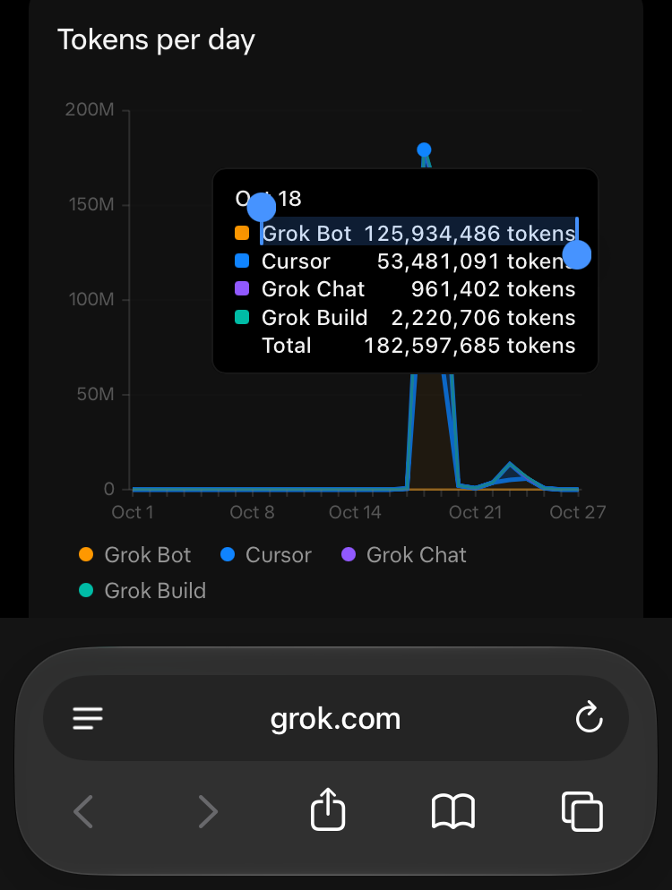

# Grok Bot Token Efficiency: Lessons from a 182M Token Day

**Date:** October 18, 2026  
**Author:** Sal DiStefano (with Grok)  
**Purpose:** A practical reference for operators running Grok Bots (and similar long-lived AI agents) who want to avoid runaway token spend.

---

## The Chart



**Source:** grok.com Usage chart (screenshot, Oct 18 highlighted).

| Source       | Tokens (approx.) |
|--------------|-----------------:|
| Grok Bot     | 125,934,486     |
| Cursor       | 53,481,091      |
| Grok Build   | 2,220,706       |
| Grok Chat    | 961,402         |
| **Total**    | **182,597,685** |

That single day consumed roughly a full week’s budget. The rest of the month was near-flat (with a smaller bump around Oct 22–23). The spike was **not** a silent 24/7 background drain—it happened while the operator was active and spawning parallel helpers and cloud agents.

---

## How Tokens Actually Get Spent

1. **Context tax** — Every turn and tool call re-sends the prior chat + tool results. Long threads become expensive even for tiny asks.
2. **Fan-out** — Every helper, cloud agent, or peer message starts its own full context. Parallel work multiplies cost.
3. **Loops** — Retries, polling, re-reads, and “verify the write” burn tokens with little new value.
4. **Skill / tool bloat** — Loading large skills or dumping whole files into context costs money before any useful work happens.
5. **Wakeups you didn’t type** — @bot mentions, peer agents, routines, and leftover background jobs.

**Expensive asks:** “look into…”, “set up the team”, “fix everything”, open-ended research, multi-repo PRs, anything that spawns helpers.  
**Cheap asks:** one crisp question, one file edit, one link to check, a yes/no decision.

---

## Operating Rules That Keep Spend Low

### Standing controls
- Do only what was asked. Read the minimum. Prefer targeted edits.
- ≤5 tool calls, then ask before continuing.
- No polling, retries, or sub-agents unless explicitly requested.
- Short replies. No unprompted or new recurring work.
- One clarifying question when ambiguous.
- Use Drive (or equivalent) as durable memory—don’t re-derive state in chat.
- Stay idle unless the human messages that specific chat. External mentions are report-only.
- Cap on-demand spend in settings. Check Usage after any big day.
- Keep routines paused (or delete ones that never ran) until you deliberately re-enable them.

### How to operate cheaper
- New chat (or a Drive pointer) per workstream. Don’t grow one mega-thread.
- One ask per message. Name the deliverable and the stop condition.
- Prefer “append this section” / “answer in 5 lines” over “figure it out.”
- Park durable state in Drive. Don’t re-derive it in the conversation.
- Offload deliberately: code → specialized coding agent; long prose / drafts → the tool that is cheapest for that job; 2-minute fact checks → the front-door bot. Never two agents on the same task.

---

## Grok-Specific Efficiency Rules

These come from how Grok actually bills and caches:

- **Keep early context static.** Prompt caching discounts matching prefixes heavily. Never inject current time, status, or dynamic numbers into the front of the context. Put that in Drive and reference the link only when needed.
- **Hand over well before ~200k tokens.** Above this threshold the *entire* request (input, cached input, and output) moves to higher long-context rates.
- **Prefer deliberate Drive summary + fresh chat** over letting automatic compaction fire repeatedly. Compaction itself costs output tokens and often breaks the cache prefix on the next turn.
- **Minimize reasoning on routine work.** Reasoning tokens are billed as output tokens (the expensive category).
- **Prefer extracted / summarized tool results.** Do not re-process or paste large tool outputs into replies.
- **After significant sessions, note the main cost driver** from the Usage chart (context growth, tool volume, reasoning, or fan-out).
- **Future routines:** extremely narrow, infrequent, short-output only. Prefer event-triggered over polling.
- **Helpers / sub-agents (when allowed):** one-shot brief + Drive pointer. Demand only the final artifact back—no intermediate status chatter.

---

## How to Apply These Rules to Every Future Bot

There is no account-wide default that automatically injects rules into new Grok Bots. Each bot is created independently.

**How to apply:**
- Include this short standing instruction in the **description** field every time you create a new bot:

```
Follow the Token Budget & Team Operating Plan: https://docs.google.com/document/d/1ixW-Cmuvl8L5Cl6SkLveJ_2UNzaf-zMmsWb8NViEeG4
Standing rules: do only what was asked; short replies; ≤5 tool calls then ask; no polling/retries/subagents unless asked; stay idle unless Sal messages this chat; Drive as memory; no unprompted work.
```

- The description becomes the bot’s permanent standing instructions.
- Still set a hard spend cap in Grok Bot settings (the only true account-level control).
- Keep a single source-of-truth document (like the one linked above) and reference it in every bot description so updates stay centralized.

### What happens when you give a bot the rules (example)

> Follow the Token Budget & Team Operating Plan: https://docs.google.com/document/d/1ixW-Cmuvl8L5Cl6SkLveJ_2UNzaf-zMmsWb8NViEeG4  
> Standing rules: do only what was asked; short replies; ≤5 tool calls then ask; no polling/retries/subagents unless asked; stay idle unless Sal messages this chat; Drive as memory; no unprompted work.

Bot response:
> Got it — adopting that plan as standing rules for this bot.  
> Saved. I’ll follow that plan going forward.

**Is the full document now in the bot’s context and repeated on every send and reply?**  
No. The full doc isn’t pasted into every turn.  
The bot saves a short standing-rules summary in its durable memory, so it keeps those constraints in mind. The Drive doc stays the source of truth if the rules need to be re-read or updated — it isn’t repeated on every send or reply.

---

## Quick Checklist

- [ ] Standing instructions are static (cache-friendly)
- [ ] Dynamic state lives in Drive
- [ ] One workstream = one chat (or fresh handover with summary)
- [ ] Explicit stop condition on every non-trivial ask
- [ ] ≤5 tool calls before checking in
- [ ] Short replies + minimal reasoning for routine work
- [ ] Usage checked after any large day
- [ ] Routines paused unless deliberately re-enabled
- [ ] New bots include the standing rules in their description

---

*This is a real operator failure mode (context tax + fan-out + loops) that is easy to recreate and easy to avoid once you see the numbers. Numbers and chart are from the author’s own grok.com Usage dashboard on 2026-10-18.*
